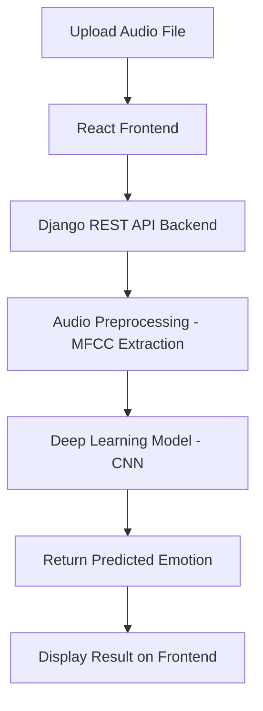

# 🎙️ Speech Emotion Recognition Web Application


A full-stack web application that classifies **human emotions** from uploaded **speech audio files** using Deep Learning.  
Built with **Django (Python Backend)** and **React.js (Frontend)** for a seamless, interactive experience.

---

## 🧠 Problem Statement

Speech carries deep emotional cues. Recognizing emotions from voice can empower:

- 🤖 Virtual assistants to respond empathetically  
- 📞 Customer support centers to assess client mood  
- 🧑‍⚕️ Healthcare professionals to monitor mental well-being  
- 🎮 Gaming & entertainment to create immersive experiences  

This project focuses on **offline emotion detection** from **pre-recorded audio files**, predicting emotions like **Angry**, **Happy**, **Sad**, etc.

---

## ✨ Features

- 🎤 Upload an audio file (WAV format) to classify emotion
- 🧠 Deep Learning model trained for high accuracy
- 🌐 REST APIs built using Django
- 🖥️ Interactive React.js frontend
- 🧪 Multiple model architectures tested (LSTM, CNN, CLSTM)
- 🚀 Codebase ready for future real-time implementation

---

## 🚀 Tech Stack

| Layer        | Tools / Frameworks                      |
|--------------|------------------------------------------|
| **Frontend** | React.js, Axios, Material-UI             |
| **Backend**  | Django, Django REST Framework            |
| **ML/DL**    | TensorFlow, Keras, scikit-learn, librosa |
| **Database** | SQLite (for development)                 |
| **Others**   | Pickle, Jupyter Notebook, Git            |

---

## 🗂️ Datasets

We used the **RAVDESS** dataset for training and testing.
- 🎵  **cermad(Crowd Sourced Emotional Multimodal Actors Dataset)**
    
     [Download cermad Dataset](https://www.kaggle.com/datasets/ejlok1/cremad)
- 🎵 **RAVDESS (Ryerson Audio-Visual Database of Emotional Speech and Song)**:  
  [Download RAVDESS Dataset](https://www.kaggle.com/datasets/uwrfkaggler/ravdess-emotional-speech-audio)
 
- 🎙️ **TESS**:  
  [Download TESS Dataset](https://www.kaggle.com/datasets/ejlok1/toronto-emotional-speech-set-tess)

- 🎤 **SAVEE**:  
  [Download SAVEE Dataset](https://www.kaggle.com/datasets/ejlok1/surrey-audiovisual-expressed-emotion-savee)


## 🧪 Model Training Overview

We experimented with **three different Deep Learning models**:

| Model    | Description                   | Accuracy | Status               |
|----------|--------------------------------|----------|-----------------------|
| 🧠 LSTM   | Long Short-Term Memory         | ~85%     | Commented (lower perf.)|
| 🧠 CLSTM  | CNN + LSTM hybrid              | ~88%     | Commented (moderate perf.)|
| ✅ CNN    | Convolutional Neural Network   | **94%**  | ✅ Used in production |

- **CNN achieved the best accuracy (94%)** and was chosen for deployment.
- **Further improvements** can be made by increasing the number of epochs and fine-tuning the model.
- The other models (LSTM and CLSTM) are still present in the training code, but **commented out**.

---

## 📊 Results

- ✅ **Model Used**: CNN
- 🎯 **Validation Accuracy**: 94%
- ⏳ **Potential**: Can be improved by:
  - Training for more epochs
  - Optimizing model hyperparameters
  - Expanding the training dataset

---

## 🏗️ System Architecture



## 📂 Project Structure
```
emotion_recognition/
├── emotion-frontend/            # React frontend
│   ├── public/
│   └── src/
│       ├── components/
│       ├── services/
│       └── App.js
├── emotion_recognition/         # Django backend
│   ├── emotion_app/             # Django app
│   ├── media/                   # Uploaded audio files
│   ├── models/                  # Saved models (.h5, .pkl)
│   ├── predict/                 # Prediction logic (model loading, audio feature extraction)
│   ├── manage.py
│   └── db.sqlite3
├── datasets/                    # Datasets for training
├── notebooks/                   # Jupyter notebooks for model training
│   └── train_model.ipynb
├── requirements.txt             # Python dependencies
└── README.md                    # 📄 You are here!
```

# ⚙️ How to Run Locally
1. Clone the repository
```bash
git clone https://github.com/yourusername/emotion_recognition.git
cd emotion_recognition
```
2. Backend Setup (Django)
```bash
cd emotion_recognition
python -m venv venv
source venv/bin/activate  # or venv\Scripts\activate on Windows
pip install -r requirements.txt
python manage.py migrate
python manage.py runserver
```
The Django backend will run at http://localhost:8000

3. Frontend Setup (React)
```bash
cd emotion-frontend
npm install
npm start
```
The React app will be running at http://localhost:3000

# 📈 Model Training (Optional)
If you want to train the models yourself:

- Open `notebooks/train_model.ipynb`
- Choose model architecture (CNN / LSTM / CLSTM)
- Run all cells to train and export your model

# 📣 Future Enhancements
- 🔥 Live Real-Time Emotion Detection (Microphone Input)
- 📈 Deploying to cloud (AWS, Azure, GCP)
- 🛡️ User Authentication & History Tracking
- 🎨 UI/UX Improvements with Animations
- 📡 WebSocket Integration for Real-time Prediction

# 🙋‍♂️ Contributing
Pull requests are welcome.  
For major changes, please open an issue first to discuss what you would like to change.

Don't forget to leave a ⭐ if you like this project!

# 📝 License
This project is open-source and available under the MIT License.

